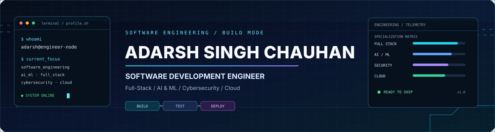
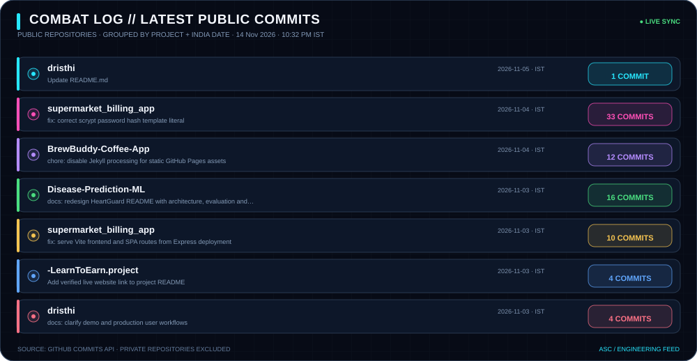

  

  

  
  
  
  
  

  

---

<table>
  <tr>
    <td width="24%" align="center" valign="middle">
      
    </td>
    <td width="76%" valign="middle">
      <h2>ADARSH SINGH CHAUHAN</h2>
      <h3>Software Development Engineer · Software Engineer</h3>
      
Building useful digital products through full-stack engineering, AI-enabled applications and disciplined software delivery.

      

        <strong>Education:</strong> B.Tech — Computer Science &amp; Engineering (Cyber Security), SIRT Bhopal · RGPV University · Expected 2027 
        <strong>Experience:</strong> SDE Intern at CONORG · May–October 2026 
        <strong>Based in:</strong> Bhopal, Madhya Pradesh, India
      

      
<a href="https://adarsh-engineering-portfolio-rust.vercel.app/"><strong>Explore my live portfolio ↗</strong></a> · <a href="https://www.linkedin.com/in/adarsh-singh-5189b9283/">Connect on LinkedIn ↗</a>

    </td>
  </tr>
</table>

## ENGINEERING FOCUS

<table>
  <tr>
    <td width="33%" valign="top">
      <h3>01 · PRODUCT ENGINEERING</h3>
      Full-stack web applications, responsive interfaces, REST APIs, backend services and database-backed workflows.
    </td>
    <td width="33%" valign="top">
      <h3>02 · AI-ENABLED SYSTEMS</h3>
      AI application development, machine learning, NLP, OCR, RAG concepts, automation and agentic workflows.
    </td>
    <td width="33%" valign="top">
      <h3>03 · QUALITY & DELIVERY</h3>
      Functional and regression testing, defect tracking, documentation, Git workflows, CI/CD and deployment.
    </td>
  </tr>
</table>

## PROFESSIONAL EXPERIENCE

**SDE Intern — CONORG, IT & Software Development**  
*15 May 2026 – 15 October 2026 · Noida, India · Completed*

- Contributed to software, website and web-application development activities for assigned project deliverables.
- Performed functional, regression and cross-browser testing; reported and tracked defects to closure.
- Supported deployment activities, technical documentation and application workflow validation.
- Worked around product domains including **e-Setu**, **GAssist** and **CTrack / PTrack**.

## SELECTED PROJECTS

<table>
  <tr>
    <td width="50%" valign="top">
      <h3><a href="https://github.com/Adarsh-Singh-Chauhan/hackverse-ai">HACKVERSE AI ↗</a></h3>
      
Gamified AI-powered hackathon ecosystem for teams, project evaluation, mentorship and event management.

      Next.js · TypeScript · NestJS · PostgreSQL · Prisma · Redis · Gemini / OpenAI
    </td>
    <td width="50%" valign="top">
      <h3><a href="https://github.com/Adarsh-Singh-Chauhan/PREPIQ">PREPIQ ↗</a></h3>
      
AI career-preparation workflows with mock interviews, analytics, roadmaps, resume analysis and coaching.

      Next.js · TypeScript · Supabase · Gemini
    </td>
  </tr>
  <tr>
    <td width="50%" valign="top">
      <h3><a href="https://github.com/Adarsh-Singh-Chauhan/DOCFORGE">DOCFORGE ↗</a></h3>
      
Document conversion and intelligence platform covering PDF processing, OCR, PDF-to-Markdown and grounded RAG.

      React · TypeScript · Python · FastAPI
    </td>
    <td width="50%" valign="top">
      <h3><a href="https://github.com/Adarsh-Singh-Chauhan/CyberSentric">CYBERSENTRIC ↗</a></h3>
      
AI-assisted cyber-defence prototype with anomaly detection and multi-agent response workflows.

      Python · React · FastAPI · Scikit-learn · WebSockets
    </td>
  </tr>
  <tr>
    <td width="50%" valign="top">
      <h3><a href="https://github.com/Adarsh-Singh-Chauhan/NEXA---Multimodal-Web-Data-Agent">NEXA ↗</a></h3>
      
Multimodal web-data agent for working with text, images and PDF inputs.

      Next.js · TypeScript · Gemini
    </td>
    <td width="50%" valign="top">
      <h3><a href="https://github.com/Adarsh-Singh-Chauhan/unisathi">UNISATHI ↗</a></h3>
      
Connected-campus product prototype with role-based workspaces and student-focused workflows.

      Web development · Product UX
    </td>
  </tr>
  <tr>
    <td width="50%" valign="top">
      <h3><a href="https://github.com/Adarsh-Singh-Chauhan/build-ship-survive-hackathon-simulator">BUILD. SHIP. SURVIVE. ↗</a></h3>
      
Interactive and gamified hackathon simulation experience.

      Next.js · React · TypeScript · Zustand
    </td>
    <td width="50%" valign="top">
      <h3><a href="https://github.com/Adarsh-Singh-Chauhan/Disease-Prediction-ML">DISEASE PREDICTION ML ↗</a></h3>
      
Machine-learning classification project using structured health-related input data.

      Python · Pandas · NumPy · Scikit-learn
    </td>
  </tr>
</table>

## TECHNOLOGY STACK

  

| Area | Technologies & concepts |
|---|---|
| **Languages** | Python, C, C++, JavaScript, TypeScript, HTML, CSS |
| **Frontend** | React, Next.js, Tailwind CSS, responsive UI, Framer Motion |
| **Backend** | Node.js, NestJS, FastAPI, REST APIs |
| **Data** | PostgreSQL, MySQL, Supabase, Prisma, Redis |
| **AI / ML** | Machine Learning, NLP, Logistic Regression, KNN, SVM, Random Forest, XGBoost, Isolation Forest, OCR, RAG concepts, Gemini / OpenAI APIs |
| **Engineering** | Functional testing, regression testing, cross-browser testing, defect tracking, GitHub Actions, Docker, technical documentation |

## CERTIFICATIONS & HIGHLIGHTS

- Oracle Certified Foundations Associate
- IBM SkillsBuild — AI & Cloud
- Cisco Networking Academy — Introduction to Cybersecurity
- **1st Place** — Graviton Science Model Competition 2023
- **Leader** — Smart India Hackathon
- Participant — National CyberShield Hackathon 2025
- Additional learning — Microsoft Azure Computer Vision App Project

## GITHUB MISSION CONTROL

  

  

  

These animated panels stay inside this GitHub profile when clicked. They refresh from public GitHub activity; private repositories and private activity are excluded. Developer Quest XP is a playful score (25 XP per public commit in the last seven days), not an official GitHub metric.

## LET'S CONNECT

  
  
  

<strong>THINK CLEARLY · BUILD BOLDLY · VALIDATE EVERYTHING · SHIP RESPONSIBLY</strong>

Vibe coding and AI-assisted prototyping—with engineering review, testing and maintainability.

