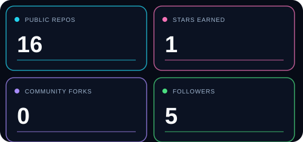
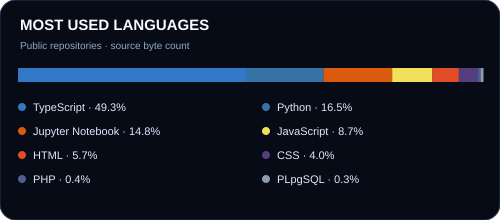

<!--
  PROFILE README — Adarsh Singh Chauhan
  Replace asset paths only if you choose different artwork.
-->

  

  

  

  
  
  

---

## 👨‍💻 About Me

I am **Adarsh Singh Chauhan**, a Software Development Engineer focused on designing, developing, testing, and deploying practical software products. I enjoy working across the engineering lifecycle — understanding requirements, shaping architecture, building user-facing experiences, integrating backend services, validating functionality, and improving delivery.

- **Primary identity:** Software Development Engineer | Software Engineer
- **Current professional experience:** Software Intern at **CONORG**, India
- **Academic background:** B.Tech, Computer Science & Engineering — SIRT, Bhopal
- **Academic score:** CGPA 8.3 (as listed on my profile)
- **Engineering interests:** scalable applications, AI-powered workflows, secure systems, automation, and cloud deployment.

> I value clear engineering, useful products, maintainable code, and software that solves real problems.

## 🧭 Engineering Specializations

| Area | Focus |
|---|---|
| Full-Stack Web Developer | End-to-end product development, frontend/backend integration |
| Frontend Engineer | Responsive interfaces, product UX, component-driven UI |
| Backend Developer | APIs, application logic, data and service integration |
| AI & Machine Learning Developer | ML workflows, model integration, intelligent applications |
| AI Application Developer | RAG, document intelligence, AI-assisted workflows |
| Automation & Agentic AI Enthusiast | Workflow automation, tool-connected agents, orchestration |
| Cybersecurity & Software Testing Enthusiast | Security-minded development, validation, QA and testing |
| Cloud & Deployment Enthusiast | Git-based delivery, hosting, deployment and operations |
| Vibe Coding & AI-assisted Development | Rapid prototyping with AI tools, iterative coding, code review and engineering validation |

## 🚀 Featured Projects

A selection of projects from my repositories. Open each repository for implementation details, setup instructions, and source code.

<table>
  <tr>
    <td width="50%" valign="top">
      <h3>📄 DOCFORGE</h3>
      
<b>Document Intelligence & Conversion Platform</b>

      
Document processing with PDF-to-Markdown extraction, OCR workflows, export options, document history, analytics, and grounded RAG-style question answering.

      
React · TypeScript · Vite · Python · FastAPI · OCR · RAG

      <a href="https://github.com/Adarsh-Singh-Chauhan/DOCFORGE">View repository →</a>
    </td>
    <td width="50%" valign="top">
      <h3>🛡️ CyberSentric</h3>
      
<b>AI-Assisted Cyber Defence Platform</b>

      
Cybersecurity project combining anomaly detection, multi-agent coordination, real-time monitoring, automated response concepts, and a security dashboard.

      
Python · React · FastAPI · Machine Learning · WebSockets

      <a href="https://github.com/Adarsh-Singh-Chauhan/CyberSentric">View repository →</a>
    </td>
  </tr>
  <tr>
    <td width="50%" valign="top">
      <h3>🎯 PREPIQ</h3>
      
<b>AI-Powered Interview & Career Preparation</b>

      
Career preparation experience featuring mock interviews, career roadmaps, performance analytics, AI coaching, certificate validation, and internship matching.

      
Next.js · Tailwind CSS · Supabase · Gemini · Framer Motion

      <a href="https://github.com/Adarsh-Singh-Chauhan/PREPIQ">View repository →</a>
    </td>
    <td width="50%" valign="top">
      <h3>🎓 UniSathi</h3>
      
<b>Campus Connection Product Prototype</b>

      
A connected campus experience with role-based workspace concepts for institutions, students, parents, teachers, and administrators.

      
Web Development · Product Design · Role-Based Workflows

      <a href="https://github.com/Adarsh-Singh-Chauhan/unisathi">View repository →</a>
      · <a href="https://adarsh-singh-chauhan.github.io/unisathi/">Live demo</a>
    </td>
  </tr>
  <tr>
    <td width="50%" valign="top">
      <h3>🕶️ CyberSentric Landing</h3>
      
<b>Cybersecurity Product Landing Page</b>

      
A product-facing web experience presenting the CyberSentric cybersecurity concept with a focused visual identity and landing-page flow.

      
Web Design · Frontend Development · Product UI

      <a href="https://github.com/Adarsh-Singh-Chauhan/Cybersentric-landing">View public repository →</a>
    </td>
    <td width="50%" valign="top">
      <h3>🎮 Hackathon Simulator</h3>
      
<b>Interactive Build-and-Pitch Simulation</b>

      
A staged hackathon simulation with team roles, timed decisions, architecture and product choices, pitch-deck building, judging, and achievement tracking.

      
Next.js · React · TypeScript · Zustand · Framer Motion

      <a href="https://github.com/Adarsh-Singh-Chauhan/build-ship-survive-hackathon-simulator">View repository →</a>
    </td>
  </tr>
  <tr>
    <td width="50%" valign="top">
      <h3>🧬 Disease Prediction ML</h3>
      
<b>Machine Learning Project</b>

      
A disease prediction project exploring data preparation, analysis, and machine-learning model development.

      
Python · Pandas · NumPy · Matplotlib · Seaborn · ML

      <a href="https://github.com/Adarsh-Singh-Chauhan/Disease-Prediction-ML">View repository →</a>
    </td>
    <td width="50%" valign="top">
      <h3>🤖 NEXA</h3>
      
<b>Multimodal Web Data Agent</b>

      
An AI-oriented web data agent project exploring multimodal workflows and AI-assisted information handling.

      
Next.js · TypeScript · Gemini API · Tailwind CSS

      <a href="https://github.com/Adarsh-Singh-Chauhan/NEXA---Multimodal-Web-Data-Agent">View repository →</a>
    </td>
  </tr>
</table>

## 🛰️ Latest Public Repositories — Auto Updated

<!-- PROFILE:RECENT-REPOS:START -->
_The first scheduled refresh will populate this list from public repositories only._
<!-- PROFILE:RECENT-REPOS:END -->

  

## 💼 Professional Experience

### Software Intern — CONORG
**India**

Working in a software engineering environment with exposure to product development, application testing, deployment coordination, and technical documentation.

Project domains I have worked around include:
- **e-Setu:** agriculture and market-linkage application ecosystem.
- **GAssist:** government information repository, personal repository, and AI-enabled assistance.
- **CTrack / GPS:** GPS tracking and location-based application workflows.

My work and responsibilities span software validation, feature and workflow review, issue documentation, integration coordination, and deployment-related activities. Specific contributions should be read alongside the relevant project and team context.

## 🧰 Technical Stack

  

**Development:** Python, JavaScript, TypeScript, HTML, CSS  
**Frontend:** React, Next.js, Tailwind CSS  
**Backend & APIs:** Node.js, FastAPI, Flask, REST APIs  
**Data & Storage:** MySQL, PostgreSQL, SQLite, Supabase  
**AI & ML:** Machine Learning, Gemini API, OCR, RAG concepts, AI integrations  
**Engineering & Delivery:** Git, GitHub, Docker, AWS fundamentals, Vercel, Linux  
**Quality:** Software Testing, QA workflows, debugging, technical documentation

## 📊 GitHub Engineering Metrics

  

  

  

## 🐍 Contribution Trail

  

The contribution snake and the profile's public metrics are regenerated automatically by GitHub Actions. Private/locked repositories are excluded.

## ⚡ Latest Public Activity

<!-- PROFILE:PUBLIC-ACTIVITY:START -->
_The first scheduled refresh will populate recent public events._
<!-- PROFILE:PUBLIC-ACTIVITY:END -->

## 🎯 Current Engineering Focus

- Building dependable full-stack applications from requirements to deployment.
- Exploring practical AI/ML integrations, agentic workflows, and document intelligence.
- Using **Vibe Coding** for rapid prototyping while retaining human review, testing, and engineering ownership.
- Improving software quality through systematic testing, debugging, and secure development.
- Learning more about cloud infrastructure, automation, and reliable deployment.

## 🤝 Connect

  
  

  <i>Engineering mindset: understand the problem · design the system · build with purpose · test carefully · ship responsibly.</i>

  

